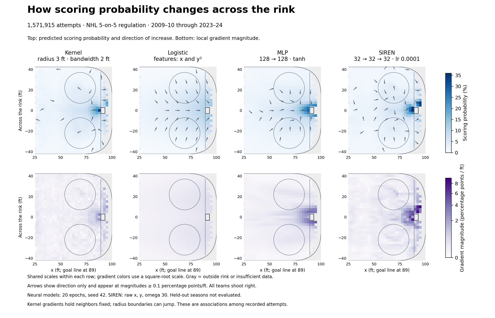

# rinklab

Neural representations research with hockey data.

## xG geometry

How does the probability of scoring in the NHL vary with shot location?
I compared kernel regression, logistic regression, an MLP, and a
[SIREN](https://arxiv.org/abs/2006.09661) using 1.57 million recorded 5-on-5
attempts from 2009–10 through 2023–24.



The top row shows scoring probabilities, with arrows pointing toward higher
predictions. The bottom row shows how quickly those predictions change with
location. Each row uses a shared color scale. Arrows have equal length and are
hidden below 0.1 percentage points per foot, so nearly flat regions do not look
as directional as stronger gradients.

Two settings made a substantial difference: expanding the kernel neighborhood
from 1 ft to 3 ft, and reducing the SIREN learning rate from `1e-3` to `1e-4`.
The figure uses a **3-ft kernel radius with 2-ft Gaussian bandwidth** and a
**SIREN with three hidden layers of 32 neurons**, sine frequency 30, and raw
`(x, y)` inputs. The MLP has two 128-neuron tanh layers. Both networks were
trained for 20 epochs with seed 42 and binary cross-entropy.

For this SIREN, widening the kernel radius from 1 ft to 3 ft reduced median
gradient-direction disagreement from **83.8° to 35.5°** on the same 819 nonflat
locations. This is agreement between models, not evidence that either gradient
is ground truth. Adding signed radial distance and angle did not materially
improve agreement in these runs.

These surfaces describe recorded attempts, not the causal effect of moving a
shot. Behind-net records include bank shots and wraparounds, and the kernel's
hard neighborhood cutoff can introduce jumps. Final test seasons remain held
back; these figures do not establish predictive superiority.

### Reproduce

From `xG/`, install `requirements.txt`, download the season data with
`download_shots.py`, then run:

```sh
python compare_geometry.py --radius 3 --bandwidth 2 --siren-hidden-sizes 32 32 32 --siren-lr 1e-4
```

This fits all four models and regenerates the graphic. To redraw saved outputs
without training, run `python compare_geometry.py --plot-only`.

`SIREN2D` accepts custom hidden-layer widths and raw or engineered coordinate
features for further experiments. Model checkpoints and downloaded data are
kept locally.
